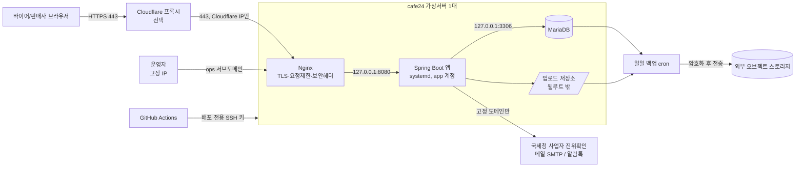

# 계측기·전자부품 B2B 견적 마켓플레이스 개발 Spec (보안 중심)

작성일: 2026-11-03

---

## 1. 개요와 전제

여러 유통사가 입점하는 계측기·전자부품 B2B 견적 플랫폼을 신규로 구축합니다. 운영자는 직접 판매하지 않고, 결제는 사이트 밖에서 하며, 수익은 판매사 구독료만 받습니다. 그래서 이 시스템은 "쇼핑몰"이 아니라 **판매사용 견적·가격관리 SaaS + 바이어용 통합 카탈로그**로 설계합니다.

**사업 전제**

- 사이트 안에서는 카드결제·PG를 쓰지 않습니다. 따라서 카드정보를 저장하지 않고 PCI-DSS 범위 밖에 둡니다.
- 바이어가 장바구니에 담으면 판매사별로 견적서가 자동 생성됩니다. 발주·세금계산서·입금은 판매사와 바이어가 직접 처리합니다.
- 판매사는 회원 등급(예: 일반/우수/대리점)별 단가를 직접 관리하고, 해당 등급의 바이어에게만 노출합니다.
- 구독료는 초기에 계좌이체와 세금계산서로 받습니다. 정기결제 PG는 2단계에 검토합니다.

**인프라 전제 (확인 필요)**

- cafe24 **가상서버호스팅**(Linux VM, root 권한)을 가정합니다. 공유형 "웹호스팅"에서는 Spring Boot 상주 프로세스를 띄울 수 없고 방화벽 설정도 불가능하므로 이 Spec의 대상이 아닙니다.
- 1단계는 단일 서버(웹+앱+DB 동거, 4vCPU/8GB 이상 권장)로 운영하고, 2단계에 DB 분리를 검토합니다.

**기술 스택**

| 영역 | 선택 | 이유 |
| --- | --- | --- |
| 언어/런타임 | Java 17 LTS (Temurin) | 기존 팀 역량, 장기 지원 |
| 프레임워크 | Spring Boot 3.x, Spring Security 6 | 인증·CSRF·헤더 보안 기본 제공 |
| 화면 | Thymeleaf SSR + 최소 JS(htmx 또는 Alpine.js) | 자동 이스케이프로 XSS 위험 감소, SPA보다 토큰 관리 부담이 적음 |
| 데이터 접근 | MyBatis 3 (파라미터 바인딩 `#{}` 강제) | 견적·가격 쿼리가 복잡함, 팀이 익숙함 |
| DB | MariaDB 10.11 LTS (utf8mb4) | cafe24 표준 이미지, 무료 |
| 웹서버 | Nginx (리버스 프록시, TLS 종단) | 정적파일, 요청 제한, 헤더 제어 |
| 마이그레이션 | Flyway | 스키마 이력 관리, 수동 DDL 금지 |
| 빌드/배포 | Gradle, GitHub Actions → 실행 JAR + systemd | 소스 복사 배포 금지, 재현 가능한 산출물 |
| 문서 출력 | 견적서 PDF: OpenPDF 또는 Flying Saucer | 서버에서 생성, 위변조 방지 번호 부여 |

---

## 2. 시스템 아키텍처



- 외부에 열리는 포트는 443(및 리다이렉트용 80)뿐입니다. 앱(8080)과 DB(3306)는 localhost에만 바인딩합니다.
- 운영자 화면은 별도 서브도메인으로 분리하고 IP 허용목록으로 막습니다.
- 앱이 바깥으로 나가는 호출은 정해진 외부 서비스(사업자 진위확인, 메일, 알림톡)만 허용합니다.

**앱 내부 모듈 구성**

| 모듈 | 책임 |
| --- | --- |
| `auth` | 가입, 로그인, 2FA, 비밀번호 재설정, 세션 |
| `org` | 회사(바이어/판매사/운영사), 소속 사용자, 역할 |
| `catalog` | 상품, 분류, 사양 검색 |
| `pricing` | 등급, 등급별 단가, 바이어 등급 부여, **가격조회서비스(유일한 단가 출구)** |
| `quote` | 장바구니, 판매사별 견적 분할, 견적요청·회신, PDF |
| `subscription` | 판매사 구독 등급, 만료 처리 |
| `file` | 업로드 검증, 저장, 권한 확인 다운로드 |
| `audit` | 감사로그, 로그인 이력, 이상징후 알림 |
| `ops` | 운영자 기능(입점 심사, 공지, 신고) |

---

## 3. 기능 범위 (MVP)

MVP는 "판매사가 혼자 써도 가치 있는 견적 도구"에 집중합니다. 광고, 사이트 내 결제, 채팅은 제외합니다.

| 사용자 | 기능 | MVP | 보안 포인트 |
| --- | --- | --- | --- |
| 바이어 | 회원가입(사업자번호 인증), 로그인, 회사 소속 담당자 추가 | O | 사업자 진위확인 API, 비밀번호 정책, 2FA 선택 |
| 바이어 | 상품 검색(모델명·제조사·사양), 판매사별 비교 | O | 비로그인 시 가격을 숨기거나 공개가만 노출 |
| 바이어 | 장바구니 → 판매사별 자동견적 분할, 견적서 PDF | O | 가격은 항상 서버에서 재계산, 클라이언트 값 불신 |
| 바이어 | 견적요청(수량·납기·비고), 견적 이력 | O | 본인 회사 견적만 조회(IDOR 방지) |
| 판매사 | 상품 등록·엑셀 일괄 업로드, 재고·납기 표시 | O | 업로드 파일 검증, 수식 인젝션 차단 |
| 판매사 | 회원 등급 정의, 등급별 단가·수량할인, 바이어에 등급 부여 | O | 다른 판매사·다른 등급 가격 완전 격리 |
| 판매사 | 견적요청 수신·회신(단가 수정 가능), 알림(메일/알림톡) | O | 알림 본문에 가격을 넣지 않고 링크로 로그인 유도 |
| 판매사 | 직원 계정·역할(대표/가격관리/영업) | O | 최소 권한, 퇴사자 즉시 비활성 |
| 판매사 | 견적 통계, 구독 등급·청구 내역 | O | 본인 테넌트 데이터만 집계 |
| 운영자 | 판매사 입점 심사·승인, 구독 등급 부여, 만료 처리 | O | 별도 도메인·IP 제한·필수 2FA |
| 운영자 | 공지, 신고 처리, 감사 로그 조회 | O | 운영자도 판매사 단가는 기본 비열람(사유 기록 후 열람) |
| 전체 | 상품 상단노출, 엑스포트 API, ERP 연동 | 2단계 | API 키 발급·폐기, 호출량 제한 |

**자동견적 계산 규칙**

1. 바이어가 장바구니에 상품과 수량을 담습니다. 저장되는 값은 상품 ID와 수량뿐입니다.
2. 서버가 (판매사, 바이어 회사의 등급, 수량 구간)으로 단가를 조회합니다. 등급을 받지 않은 바이어는 기본 등급 단가를 받습니다.
3. 판매사별로 견적서를 나누고, 공급가·부가세·합계를 `BigDecimal`로 계산합니다(원 단위 절사, 규칙은 판매사 설정).
4. 발행 시점의 단가를 견적 행에 스냅샷으로 저장합니다. 이후 단가가 바뀌어도 이미 발행된 견적은 변하지 않습니다.
5. 견적서에는 견적번호, 유효기간, 검증용 QR(견적 진위 조회 URL)을 넣습니다.

---

## 4. 권한·회원 모델

가장 큰 보안 리스크는 **한 판매사의 등급별 단가가 다른 판매사나 다른 등급 바이어에게 보이는 것**입니다. 그래서 격리를 화면이 아니라 데이터 접근 계층에서 강제합니다.

**역할 (RBAC)**

| 역할 | 소속 | 허용 | 금지 |
| --- | --- | --- | --- |
| `BUYER_ADMIN` | 바이어 회사 | 담당자 초대·해제, 회사 전체 견적 조회 | 다른 회사 데이터 |
| `BUYER_USER` | 바이어 회사 | 장바구니, 견적요청, 본인 견적 조회 | 회사 설정 변경 |
| `SELLER_OWNER` | 판매사 | 직원 관리, 구독, 모든 판매사 기능 | 다른 판매사 데이터 |
| `SELLER_PRICING` | 판매사 | 상품·등급·단가 관리 | 직원·구독 관리 |
| `SELLER_SALES` | 판매사 | 견적요청 회신, 바이어 등급 부여 | 단가표 수정 |
| `OPS_ADMIN` | 운영사 | 입점 심사, 구독, 공지, 감사로그 | 사유 기록 없는 단가 열람 |
| `OPS_SUPPORT` | 운영사 | 문의·신고 처리, 계정 잠금 해제 | 입점·구독 변경 |

**테넌트 격리 규칙**

1. 로그인 시 세션에 `orgId`와 `orgType`(BUYER/SELLER/OPS)을 고정합니다. 요청 파라미터로 넘어온 회사 ID는 절대 쓰지 않습니다.
2. 판매사가 소유한 테이블(상품, 등급, 단가, 견적)을 조회하는 모든 쿼리에 `seller_id = #{ctx.orgId}` 조건을 붙입니다. MyBatis 인터셉터나 매퍼 규칙 테스트로 누락을 빌드 단계에서 잡습니다.
3. 바이어에게 보이는 단가는 오직 `가격조회서비스`를 통해서만 나갑니다. 이 서비스는 "이 바이어 회사가 이 판매사에서 받은 등급"의 단가 한 줄만 돌려줍니다. 등급 목록이나 다른 등급의 단가는 응답에 싣지 않습니다.
4. URL에 들어가는 리소스 ID(견적번호 등)는 추측 가능한 자동증가 값 대신 ULID를 쓰고, 조회할 때 소유권을 다시 확인합니다.
5. 운영자가 판매사 데이터를 열람할 때는 "사유 입력 → 감사로그 기록 → 30분 한시 권한" 방식만 허용합니다.
6. 구독이 만료된 판매사는 판매사 기능을 읽기 전용으로 전환하고 카탈로그 노출을 중지합니다.

---

## 5. 데이터 모델 (핵심 테이블)

모든 테이블에 `created_at/by`와 `updated_at/by`를 두고, 삭제는 `deleted_at`을 쓰는 소프트 삭제로 처리합니다. 개인정보는 아래 "보호" 열에 따라 암호화합니다.

| 테이블 | 핵심 컬럼 | 보호 |
| --- | --- | --- |
| `org` | org_id, org_type(BUYER/SELLER/OPS), 상호, 사업자번호, 상태(심사중/승인/정지) | 사업자번호는 공개정보이므로 평문 |
| `app_user` | user_id, org_id, 로그인ID(이메일), password_hash, mfa_secret, 실패횟수, 잠금시각, 마지막로그인 | 비밀번호 argon2id(또는 bcrypt), mfa_secret AES-256-GCM |
| `user_profile` | user_id, 이름, 휴대폰, 부서, 직책 | 휴대폰 AES-256-GCM + 검색용 HMAC 해시 |
| `user_role` | user_id, role | - |
| `seller_subscription` | seller_id, plan(FREE/STD/PRO), 시작일, 종료일, 청구금액, 입금확인일 | - |
| `product` | product_id, seller_id, 제조사, 모델명, 분류, 사양(JSON), 납기, 공개가 | - |
| `price_tier` | tier_id, seller_id, 등급명, 기본여부 | - |
| `tier_price` | product_id, tier_id, 최소수량, 단가 | **민감 영업정보**: 가격조회서비스 외 접근 금지 |
| `buyer_tier` | seller_id, buyer_org_id, tier_id, 부여자, 부여일 | 바이어에게 등급명 비노출(선택) |
| `cart_item` | buyer_user_id, product_id, 수량 | 가격 컬럼 없음 |
| `quote` | quote_id(ULID), buyer_org_id, seller_id, 상태(요청/회신/만료/취소), 유효기한, 합계, 검증토큰 | - |
| `quote_line` | quote_id, product_id, 수량, 단가스냅샷, 모델명스냅샷 | - |
| `attachment` | file_id(UUID), owner_org_id, 원본명, 저장경로, MIME, 크기, SHA-256 | 웹루트 밖 저장 |
| `audit_log` | 시각, user_id, org_id, IP, 행위, 대상, 전후값 요약 | append-only, 운영 DB 계정에 UPDATE/DELETE 권한 없음 |
| `login_history` | user_id, 시각, IP, UA, 결과 | 1년 보관 후 파기 |

---

## 6. 애플리케이션 보안 요구사항

기준은 OWASP ASVS 4.0 Level 2와 개인정보의 안전성 확보조치 기준입니다. 아래 항목은 모두 출시 전 필수입니다.

**6.1 인증**

- 비밀번호: 10자 이상, 유출 비밀번호 목록(로컬 사전)과 대조, 해시는 argon2id(또는 bcrypt cost 12).
- 로그인 5회 실패 시 15분 잠금. IP당 분당 시도 횟수를 제한합니다(Nginx `limit_req` + 앱 레벨 Bucket4j).
- 2FA(TOTP): 운영자, `SELLER_OWNER`, `SELLER_PRICING`은 필수, 바이어는 선택.
- 비밀번호 재설정: 30분짜리 1회용 토큰을 쓰고, 계정 존재 여부와 관계없이 같은 응답을 돌려줍니다.
- 회원가입: 이메일 인증 + 사업자번호 진위확인(국세청 API). 판매사는 운영자가 승인하기 전까지 비공개입니다.

**6.2 세션**

- 서버 세션(Spring Session JDBC)을 씁니다. 쿠키는 `Secure; HttpOnly; SameSite=Lax`, 로그인할 때 세션 ID를 재발급합니다.
- 유휴 30분, 절대 12시간에 만료합니다. 비밀번호나 역할이 바뀌면 해당 사용자의 세션을 모두 폐기합니다.
- 상태를 바꾸는 요청은 모두 CSRF 토큰을 검증합니다(Spring Security 기본값을 유지하고 끄지 않음).

**6.3 OWASP Top 10 대응**

| 위협 | 대응 |
| --- | --- |
| A01 접근통제 실패 | 메서드 단위 `@PreAuthorize`, 모든 쿼리에 테넌트 조건, 소유권 재확인, 권한 테스트 케이스 의무화 |
| A02 암호화 실패 | TLS 1.2+ 강제, HSTS, 개인정보 AES-256-GCM, 키는 환경변수가 아닌 root 전용 파일(600) 또는 외부 KMS |
| A03 인젝션 | MyBatis `#{}`만 허용, `${}`는 화이트리스트 정렬컬럼에만(정적 검사로 차단), Thymeleaf `th:text` 기본, `th:utext` 금지 |
| A04 안전하지 않은 설계 | 가격·합계는 서버에서만 계산, 가격 조회 요청 한도로 대량 크롤링 방지 |
| A05 보안 설정 오류 | prod에서 Actuator·Swagger·에러 스택 비노출, 기본 계정 없음, 디렉터리 리스팅 끔 |
| A06 취약한 컴포넌트 | Dependabot + OWASP Dependency-Check, CVSS 7 이상은 7일 안에 패치 |
| A07 인증 실패 | 6.1 적용, 로그인 이력 기록, 새 기기 로그인 알림 |
| A08 무결성 실패 | CI에서 빌드한 JAR만 배포, 체크섬 검증, 엑셀 매크로·수식 무시 |
| A09 로깅·모니터링 실패 | 6.6 감사로그 + 이상징후 알림 |
| A10 SSRF | 외부 URL은 고정 도메인(국세청·메일·알림톡)만 호출, 사용자가 입력한 URL을 호출하는 기능 없음 |

**6.4 파일 업로드 (상품 이미지·데이터시트·엑셀)**

- 확장자 화이트리스트(jpg, png, webp, pdf, xlsx)를 두고 Apache Tika로 실제 MIME을 검사합니다. 크기 제한은 이미지 5MB, PDF 20MB, 엑셀 10MB입니다.
- 저장 파일명은 UUID로 바꿔 웹루트 밖 디렉터리에 저장합니다. 다운로드는 권한을 확인하는 컨트롤러를 거치고 `Content-Disposition: attachment`로 내려보냅니다.
- 이미지는 서버에서 재인코딩해 EXIF와 숨은 페이로드를 제거합니다. SVG·HTML 업로드는 금지합니다.
- 엑셀은 Apache POI 스트리밍으로 파싱하고 행 수를 5만 행으로 제한합니다. 내보낼 때 `= + - @`로 시작하는 셀 값 앞에 작은따옴표를 붙여 CSV 인젝션을 막습니다.

**6.5 HTTP 보안 헤더**

- `Strict-Transport-Security: max-age=31536000; includeSubDomains`
- `Content-Security-Policy: default-src 'self'; script-src 'self'; object-src 'none'; frame-ancestors 'none'` (인라인 스크립트를 쓰지 않는다는 전제)
- `X-Content-Type-Options: nosniff`, `Referrer-Policy: strict-origin-when-cross-origin`, `Permissions-Policy`로 카메라·위치 차단
- `Server` 헤더에서 버전 제거(`server_tokens off`)

**6.6 로깅·감사**

- 감사로그 대상: 로그인과 로그인 실패, 권한·등급 변경, 단가표 수정과 일괄 업로드, 개인정보 조회·다운로드, 운영자의 판매사 데이터 열람.
- 앱 로그에는 비밀번호, 토큰, 휴대폰, 단가를 남기지 않습니다(Logback 마스킹 패턴).
- 접속기록은 최소 1년 보관하고 월 1회 이상 점검합니다(개인정보 안전성 확보조치 기준).
- 알림 규칙: 같은 IP에서 10분에 로그인 실패 50회, 한 계정이 시간당 가격 조회 1,000회, 운영자 열람 발생 시 메일·메신저로 알립니다.

---

## 7. cafe24 인프라·운영 보안

외부에 열리는 포트는 80/443 두 개뿐이고, 나머지는 모두 localhost 또는 지정 IP로만 허용합니다. 서버가 한 대이므로 백업은 반드시 서버 밖에 둡니다.

**7.1 서버 하드닝 (Rocky Linux 9 또는 Ubuntu 22.04 LTS)**

- SSH: 포트를 바꾸고, root 로그인과 비밀번호 로그인을 금지하고, 키 인증만 쓰며, 관리자 고정 IP에서만 허용합니다.
- fail2ban(SSH·Nginx)과 자동 보안 업데이트(dnf-automatic/unattended-upgrades)를 설정합니다.
- 앱은 로그인할 수 없는 전용 계정(`app`)으로 systemd에서 실행합니다. `NoNewPrivileges`, `ProtectSystem=strict`를 켜고, 쓰기 가능한 경로는 로그·업로드 디렉터리만 둡니다.
- 시간 동기화(chrony), 타임존 Asia/Seoul.

**7.2 방화벽·네트워크**

| 포트 | 서비스 | 허용 범위 |
| --- | --- | --- |
| 80 | Nginx (443으로 리다이렉트만) | 전체 |
| 443 | Nginx (TLS) | 전체 |
| 변경된 SSH | sshd | 관리자 고정 IP |
| 8080 | Spring Boot | 127.0.0.1 전용 |
| 3306 | MariaDB | 127.0.0.1 전용 (외부 접속은 SSH 터널) |

- cafe24 콘솔 방화벽과 서버의 firewalld/ufw를 둘 다 적용합니다.
- 운영자 화면(`/ops/**`)은 별도 서브도메인으로 분리하고 Nginx IP 허용목록을 겁니다.
- DDoS: cafe24 기본 방어에 더해, 도메인 DNS를 Cloudflare(무료 플랜) 프록시로 두는 안을 권장합니다. 이 경우 원본 서버 443은 Cloudflare IP만 허용합니다.

**7.3 TLS**

- Let's Encrypt(certbot 자동갱신) 또는 cafe24 유료 인증서를 씁니다. TLS 1.2/1.3만 허용하고 Mozilla "Intermediate" 암호 설정을 적용해 SSL Labs A 등급을 목표로 합니다.
- 갱신 실패 시(만료 14일 전) 알림을 보냅니다.

**7.4 DB**

- 앱 계정은 서비스 스키마의 DML만 갖습니다. 마이그레이션 계정은 DDL 전용이며 배포할 때만 씁니다. `audit_log`의 UPDATE/DELETE 권한은 회수합니다.
- `mysql_secure_installation`을 수행하고, 원격 root를 차단하고, 익명 계정과 test DB를 삭제합니다.
- DB 비밀번호와 암호화 키는 Git에 넣지 않고 `/etc/app/secrets.env`(소유자 root:app, 권한 640)로 주입합니다.

**7.5 백업·복구**

- 매일 03:00에 `mariadb-dump --single-transaction`과 업로드 디렉터리를 압축하고, 암호화(age/GPG)한 뒤 외부 저장소(예: cafe24 오브젝트 스토리지, 다른 리전)로 보냅니다.
- 보관: 일일 14개, 주간 8개, 월간 12개. 목표 RPO 24시간, RTO 4시간.
- 분기마다 1회 복구 리허설(별도 VM에 실제로 복원)을 하고 결과를 기록합니다.

**7.6 모니터링**

- 외부 가용성 체크(UptimeRobot 등)로 `/health`를 1분 간격으로 확인합니다. Actuator 관리 포트는 localhost에만 바인딩합니다.
- 디스크 80%, 메모리, 5xx 비율, 로그인 실패 급증에 알림을 겁니다.
- 로그는 logrotate로 하루 1회 회전하고, 접속기록은 1년 보관 정책에 맞춰 외부 백업에 포함합니다.

**7.7 배포**

1. GitHub Actions가 테스트와 보안점검을 통과한 JAR을 빌드하고 SHA-256을 기록합니다.
2. 배포 전용 SSH 키(`command=`로 실행 명령 제한)로 서버에 올리고 체크섬을 확인합니다.
3. Flyway 마이그레이션 → `systemctl restart app` 순서로 진행하고, 헬스체크가 실패하면 직전 JAR로 자동 롤백합니다.
4. 서버에서 소스를 직접 고치거나 파일을 복사하는 방식의 배포는 금지합니다.

---

## 8. 프로젝트 구조·개발 프로세스

**디렉터리 레이아웃 (Gradle 단일 모듈, 패키지로 도메인 분리)**

```
b2b-quote-market/
├─ build.gradle, settings.gradle, gradle/ (wrapper)
├─ src/main/java/com/<company>/quote/
│  ├─ global/        # security(config, filter, TenantContext), error, audit, util
│  ├─ auth/          # controller, service, mapper, dto
│  ├─ org/
│  ├─ catalog/
│  ├─ pricing/       # PriceQueryService = 유일한 단가 출구
│  ├─ quote/
│  ├─ subscription/
│  ├─ file/
│  └─ ops/
├─ src/main/resources/
│  ├─ application.yml, application-local.yml, application-prod.yml (비밀값 없음)
│  ├─ db/migration/  # Flyway V1__init.sql ...
│  ├─ mapper/        # MyBatis XML
│  └─ templates/, static/
├─ src/test/java/... # 단위·권한·통합 테스트 (Testcontainers MariaDB)
├─ deploy/           # nginx.conf, app.service(systemd), backup.sh, logrotate
├─ .github/workflows/ci.yml
└─ docs/개발스펙.md
```

**개발 규칙**

- 브랜치: `main`(운영 배포) / `develop` / `feature/*`. `main`에 머지하려면 PR 리뷰 1인과 CI 통과가 필요합니다.
- 커밋에 비밀값이 들어가지 않도록 gitleaks pre-commit 훅과 CI 검사를 둡니다. `.env`, `secrets.*`는 `.gitignore`에 넣습니다.
- 프로파일은 `local` / `prod` 두 가지만 둡니다. prod 설정값은 서버의 `secrets.env`로만 주입합니다.

**CI 파이프라인 (PR마다)**

1. 빌드 + 단위 테스트 + Testcontainers 통합 테스트
2. 권한 테스트: 역할 × 엔드포인트 매트릭스에서 "다른 테넌트 리소스 접근 시 403/404"를 자동으로 검증
3. 정적 분석: SpotBugs + Find Security Bugs, MyBatis `${}` 사용 금지 검사
4. 의존성 취약점: OWASP Dependency-Check (CVSS 7 이상이면 실패)
5. 비밀값 스캔: gitleaks

**출시 전 보안 점검**

- [ ] OWASP ZAP 기준선 스캔(스테이징)에서 High 0건
- [ ] 테넌트 격리 수동 점검: 판매사 A 계정으로 판매사 B의 상품·단가·견적 ID를 직접 호출
- [ ] 등급 격리 점검: 일반 등급 바이어가 대리점 단가를 받을 수 없는지 확인
- [ ] SSL Labs A 등급, 보안 헤더 확인(securityheaders.com)
- [ ] 백업 복원 리허설 1회 성공
- [ ] 개인정보 처리방침·이용약관 게시

---

## 9. 법적·컴플라이언스

| 항목 | 내용 | 조치 |
| --- | --- | --- |
| 통신판매중개업 | 여러 판매사 상품을 게시하므로 중개자 지위로 볼 가능성이 높음 | 통신판매업 신고, 사이트에 "운영자는 통신판매중개자이며 거래 당사자가 아님" 고지, 판매사 정보(상호·대표·사업자번호·연락처) 표시 |
| 개인정보보호법 | 바이어·판매사 담당자의 이름·연락처 처리 | 개인정보 처리방침, 수집·이용 동의(필수/선택 분리), 안전성 확보조치(암호화·접근통제·접속기록 1년), 탈퇴 시 파기 |
| 개인정보 제3자 제공 | 견적요청 시 바이어 담당자 정보가 판매사에 전달됨 | 견적요청 화면에서 "선택한 판매사에 담당자 정보 제공" 동의를 받음 |
| 정보통신망법 | 알림·광고성 메일/알림톡 | 광고성 정보는 별도 수신동의, 야간(21~08시) 발송 제한 |
| 전자세금계산서 | 구독료 청구 | 운영자가 구독료 세금계산서를 발행. 상품 대금 계산서는 판매사가 발행 |
| 판매사 이용약관 | 단가 정보의 비밀유지, 허위 상품 게시 금지, 구독 해지·환불 규정 | 입점 신청 시 동의 |

---

## 10. 마일스톤과 미결정 사항

**마일스톤 (착수 기준, 1~2인 개발 가정)**

| 단계 | 기간 | 산출물 | 완료 기준 |
| --- | --- | --- | --- |
| M0 기반 | 1~2주 | 서버 하드닝, Nginx/TLS, CI, 프로젝트 골격, Flyway V1 | 빈 앱이 HTTPS로 배포되고 롤백이 동작함 |
| M1 계정·조직 | 2~3주 | 가입, 로그인, 2FA, 역할, 테넌트 컨텍스트, 감사로그 | 권한 매트릭스 테스트 통과 |
| M2 카탈로그·가격 | 3주 | 상품 등록·엑셀 업로드, 등급, 등급별 단가, 가격조회서비스 | 등급 격리 점검 통과 |
| M3 견적 | 3주 | 장바구니, 자동견적 분할, 견적요청·회신, PDF, 알림 | 견적 스냅샷·진위조회 동작 |
| M4 운영·구독 | 2주 | 입점 심사, 구독 등급·만료, 운영자 화면 | 만료 시 읽기 전용 전환 확인 |
| M5 출시 점검 | 1~2주 | ZAP 스캔, 수동 침투 점검, 백업 리허설, 약관·방침 | 8장 체크리스트 전부 완료 |

**미결정 사항**

- [ ] cafe24 상품 확정: 가상서버호스팅 사양(vCPU/메모리/디스크)과 OS 이미지
- [ ] 도메인과 Cloudflare 프록시 사용 여부
- [ ] 비로그인 방문자에게 공개가를 보여줄지, 가격을 완전히 숨길지
- [ ] 바이어에게 자신의 등급명을 보여줄지
- [ ] 알림톡 발송 대행사 선정
- [ ] 암호화 키 보관: 서버 파일로 시작할지, 외부 KMS를 쓸지
- [ ] 구독 요금표 확정(무료 체험 기간, 스탠다드·프리미엄 가격)
